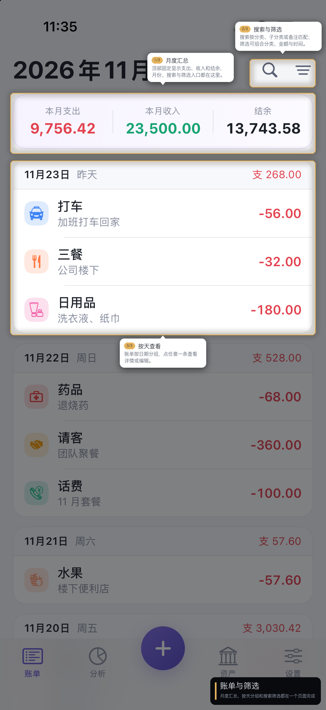
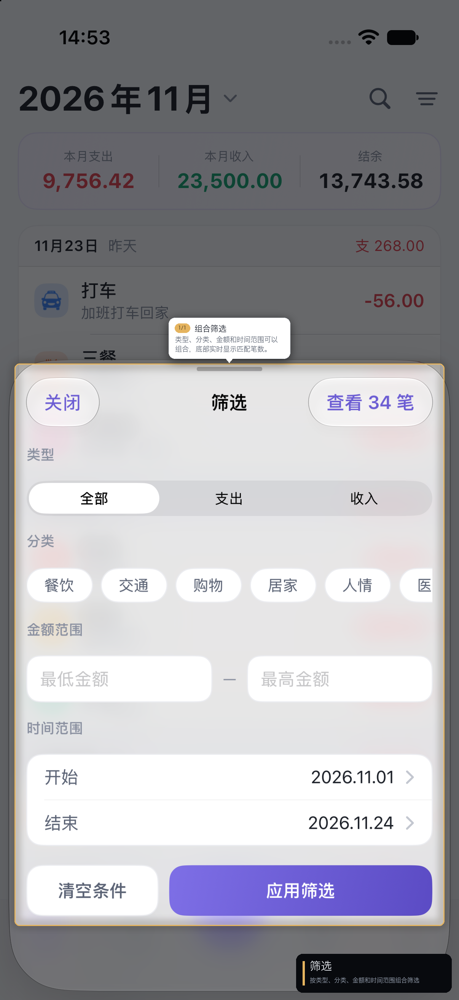
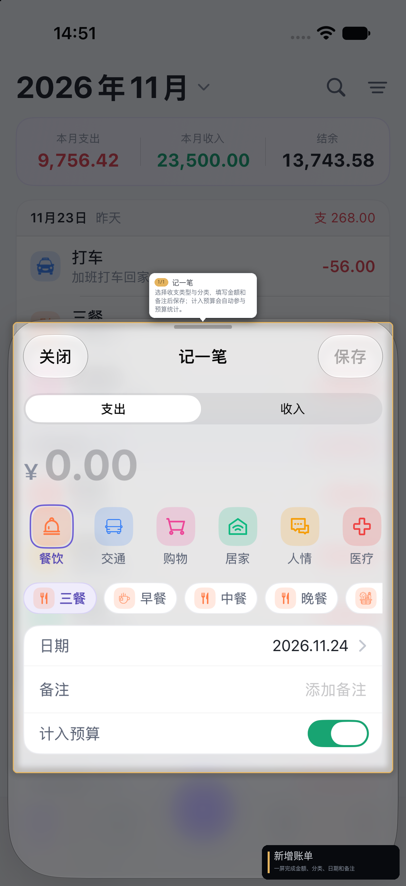
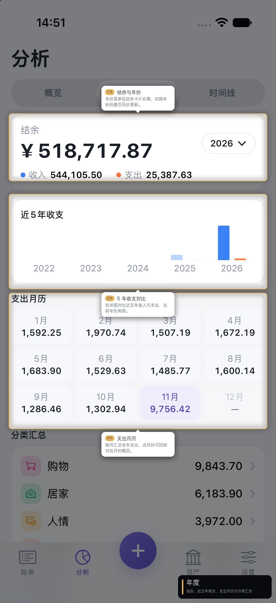
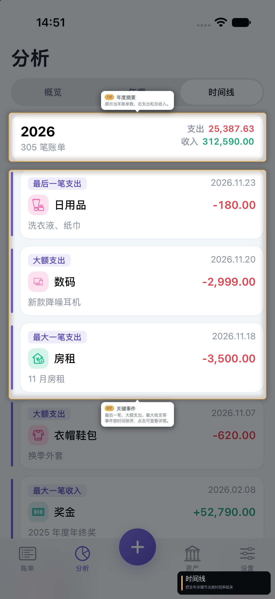
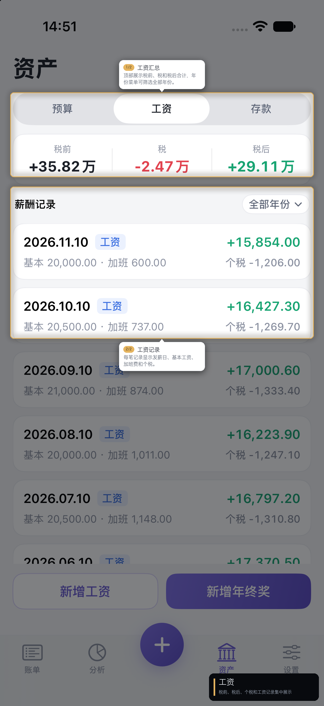
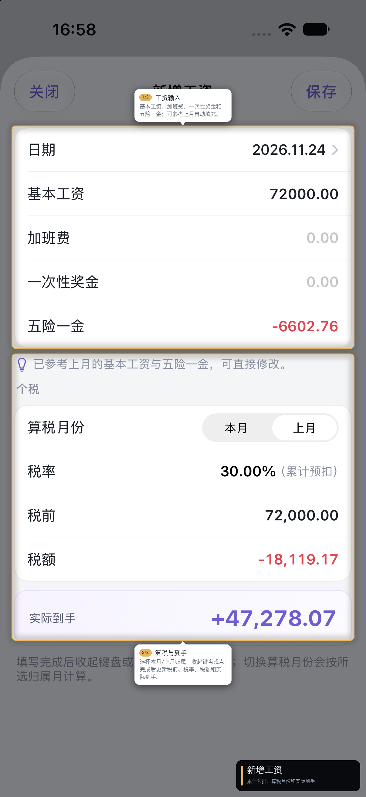
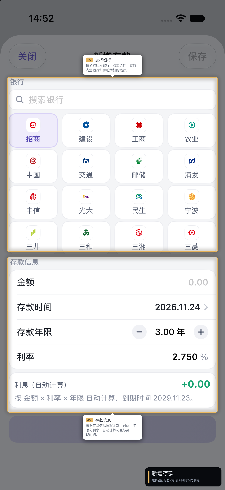
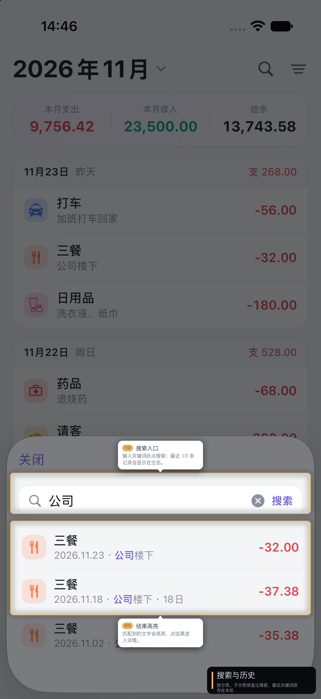
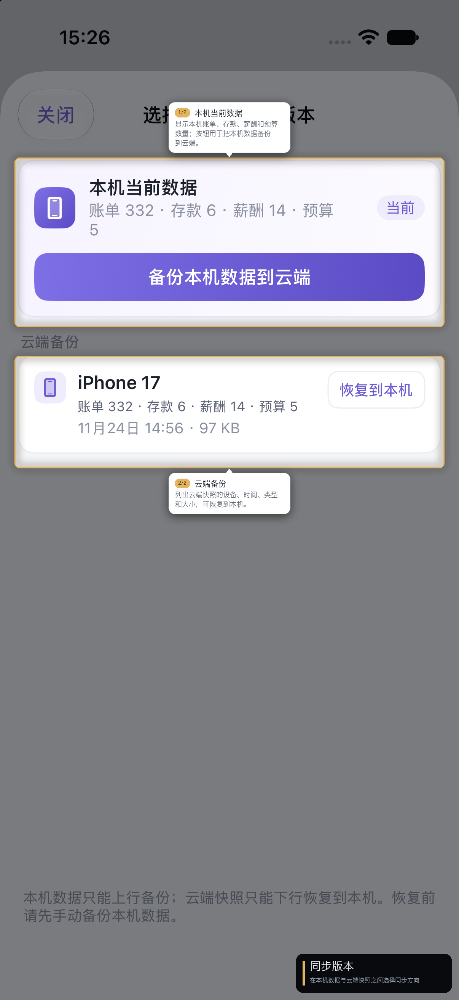

<div align="center">
  
  <h1>记账清单</h1>
  <p>一款完全本地优先的 iPhone 记账与资产管理应用。</p>
  <p><code>iOS 18+</code> · SwiftUI · SwiftData · Swift Charts</p>
</div>

**记账清单** 是把日常收支、预算、存款、工资和年度分析收进一个 iPhone App 的本地记账工具。数据默认只保存在本机 SwiftData 中；需要跨设备时，可把 JSON 快照放进 iCloud Drive、OneDrive 或任意同步目录，不需要 CloudKit 付费账号。

## 它能做什么

- **快速记账**：底部中央「＋」一屏完成类型、金额、分类、日期和备注；支出/收入用不同颜色区分。
- **按天回看**：月度汇总固定在顶部，账单按日期分组；支持月份切换、关键词搜索和组合筛选。
- **分析概览**：全部时间或单月切换，环形图展示分类占比，点击分类进入子分类明细。
- **年度分析**：结余、收入/支出、近五年柱状图、支出月历、分类汇总；年份菜单内置在结余卡片里。
- **明细排序**：分类明细支持「按时间 / 按金额」小页签排序，预排序缓存避免滚动卡顿。
- **资产中心**：预算、工资、存款三段切换，默认进入预算；预算进度、超支、工资个税和存款利息集中展示。
- **工资与个税**：累计预扣预缴税率表、五险一金扣除、本月/上月算税归属和年终奖单独计税；输入期间不实时重算，收起键盘或点完成后更新，保存时兜底重算；启动时会检测历史税额差异并弹窗询问是否按当前税率表重算，也可以保留历史数据。
- **搜索历史**：搜索页记录最近 10 条关键词，点历史直接重搜；记录只保存在本机。
- **本地优先同步**：手动/自动备份 JSON 快照到文件夹；也支持恢复桌面版 `.db` 快照。
- **数据安全**：内置银行只在本地补齐，手动添加的银行才写入云端快照；删除/恢复前可先做备份。
- **Excel 导入导出**：导出 8 个工作表；导入前预览各表条数，可选择合并导入或清空 Excel 中存在的表后覆盖导入。

## 功能介绍

### 账单与筛选



账单页把月度汇总固定在顶部，下方按日期分组展示每一笔收支。月份、搜索和筛选入口集中在顶部，点账单可以查看详情或编辑。

### 筛选



筛选支持类型、分类、金额范围和时间范围组合，底部实时显示匹配笔数。清空条件会保留当前账单范围，应用后回到账单列表。

### 新增账单



点底部中央「＋」进入记一笔：选择支出/收入与分类，填写金额、日期和备注；「计入预算」的支出会参与预算统计。

### 分析与下钻


概览默认展示全部时间，也可以切换到任意单月。环形图按支出分类汇总，点击分类进入子分类明细；金额较大时环形图会放大，中心数字自动缩放。

### 年度



年度页以结余为主数字，年份菜单在卡片右侧；下方展示近五年收支柱状图、支出月历和分类汇总，年份切换后整页同步更新。

### 时间线



时间线把全年关键节点串起来：年度摘要、最后一笔支出、大额支出、最大收支等事件按时间排序，点击可查看账单详情。

### 资产与预算


资产页用「预算、工资、存款」三段切换，默认进入预算。预算卡展示总预算、本月已花、超支或剩余以及进度条；预算项按分类维护。

### 工资



工资分段展示税前、税和税后合计，支持全部年份筛选；每笔记录展示发薪日、基本工资、加班费和个税。

### 新增工资



工资编辑支持基本工资、加班费、一次性奖金和五险一金，可参考上月自动填充；编辑已有记录时标题显示「工资详情」，税额上方展示税前。算税月份可选本月/上月；收起键盘或点完成后更新税前、税额和实际到手，保存时再兜底重算。

### 存款


存款分段展示银行数、存款笔数、总金额和总利息；每笔存款显示银行、期限、利率和利息，支持排序、更新和删除。

### 新增存款



新增存款时先选择银行，再填写金额、时间、年限和利率；利息和到期时间会实时计算。

### 搜索与历史



搜索结果会高亮匹配的分类、子分类或备注，例如搜索「公司」会匹配备注中的公司信息，点结果进入账单详情。最近 10 条搜索关键词保存在本机。

### 设置


设置页集中管理数据处理、iCloud 同步、外观、自定义分类、反馈与更新和清空数据。

### 云同步


iCloud 同步页展示同步文件夹、本机记录数、云端备份数、上次备份时间和自动备份开关；下方可以立即同步、更改同步目录或清除文件夹。

### 同步版本



点击「同步数据」后进入版本选择：上方是本机当前数据和「备份本机数据到云端」，下方列出云端快照的设备、时间、类型和大小，可选择恢复到本机。

## 核心页面

### 账单

- 顶部固定月份、本月支出/收入/结余。
- 账单按天分组；点账单进入详情，点分类进入分类明细。
- 搜索按分类、子分类和备注匹配；筛选支持类型、分类、金额范围、日期范围。
- 搜索结果高亮关键词，搜索历史存在 `UserDefaults`，不参与云同步。

### 分析

- 概览默认「全部时间」，也可切换任意月份。
- 环形图直径根据总支出金额放大，金额较长时自动缩小字号，避免超出内圆。
- 分类明细支持按时间/金额排序；排序在 `CategoryDetailData` 初始化时预计算，滚动时不重复排序。
- 年度页年份菜单在结余卡片右侧，按当前年份倒序排列。

### 资产

- 三段顺序为「预算、工资、存款」，默认预算。
- 预算：总预算、本月已花、超支/剩余、预算项；编辑页删除按钮随内容滚动，键盘弹出时保持稳定。
- 工资：基本工资、加班费、一次性奖金、五险一金、算税月份、累计税率、税前、税额、实际到手；编辑页标题为「工资详情」。
- 存款：银行、存款金额、利率、期限、利息；银行目录支持管理。

### 设置与同步

- 数据导入 / 导出 Excel（xlsx，含账单、预算、工资、年终奖、存款、银行、分类和设置 8 个工作表）；导出成功有提示，导入前可预览并选择合并或覆盖。
- CSV 仍可用于只导入账单。
- 桌面版 `.db` 快照恢复。
- 文件夹 JSON 快照：选择 iCloud Drive / OneDrive / 本地目录，支持立即备份、自动备份和恢复历史版本。
- 自定义分类、外观、清空数据、关于。

## 快速开始

### 环境

- macOS + Xcode（iOS 18 SDK 或更高）
- iPhone 模拟器或 iOS 18+ 真机

### 运行

```bash
git clone <本仓库地址>
cd Record-iOS

xcodebuild -project Record-iOS.xcodeproj \
  -scheme Record-iOS \
  -sdk iphonesimulator \
  -destination 'platform=iOS Simulator,name=iPhone 18 Pro' \
  build
```

也可以直接用 Xcode 打开 `Record-iOS.xcodeproj`，选择模拟器运行。

### 调试参数

仅在 DEBUG 构建生效：

| 参数 | 作用 |
| --- | --- |
| `-seedDemo` | 写入演示账单、资产、工资数据 |
| `-tab ledger/analysis/assets/settings` | 启动后直达对应 Tab |
| `-yearly` / `-timeline` | 分析页直达年度 / 时间线 |
| `-openSearch` / `-openFilter` | 打开搜索页 / 筛选页 |
| `-search=公司` | 配合 `-openSearch` 预填并搜索 |
| `-openEditor` | 打开新增账单页 |
| `-salary` / `-budget` / `-deposits` | 资产页直达工资 / 预算 / 存款 |
| `-openSalaryEditor` / `-openBonusEditor` | 打开工资 / 年终奖编辑器 |
| `-openDepositEditor` / `-openBanks` | 打开存款编辑器 / 银行管理 |
| `-openSync` / `-openSyncPicker` | 打开同步页 / 版本选择页 |
| `-openData` / `-excelImportPath <path>` / `-excelImportMode merge|replace` | 打开数据处理 / 自动导入 Excel / 跳过预览直接合并或覆盖 |
| `-skipTaxRecalcPrompt` | 调试时跳过历史税额重算弹窗 |

## 数据存储

### 本机

- SwiftData 数据库：App 沙盒 `Library/Application Support/Record.store`
- 工资算税配置：`UserDefaults` key `record.payroll.preferences.v1`
- 预算配置：`UserDefaults` key `record.budget.preferences.v1`
- 搜索历史：`UserDefaults` key `record.search.history.v1`
- 内置银行：SwiftData `Bank` 表，`isSystem == true`；首次安装/升级时本地补齐，不写入云快照。
- 手动银行：`isSystem == false`，写入 JSON 快照的 `customBanks`。

### 同步

同步目录默认为 `记账清单/`，移动端会识别：

- `record-backup-*.json`：移动端 JSON 快照；
- `record_*.db`：桌面版 SQLite 快照；
- `*.categories.json`：桌面版分类侧车文件；
- `latest.json`：桌面端版本提示，移动端不读取。

协议细节见 [docs/mobile-backup-sync-protocol.md](docs/mobile-backup-sync-protocol.md)。

### 备份策略

- 移动端 JSON 包含账单、分类、存款、工资、年终奖、预算和手动银行。
- 内置银行不进入 JSON；恢复时保留本机内置银行，仅替换 `customBanks`。
- 桌面 `.db` 恢复保留本机内置银行，把桌面端非内置银行作为自定义银行导入。
- 旧 JSON 没有 `customBanks` 字段时，保留本机现有自定义银行。

## App Icon

<p></p>

最终使用 **01A「账页紫光 · 金币印章」**：深紫封面、薄荷书签和压在账页右下角的金币印章。iOS 资源为 1024×1024 无透明 PNG；设计源文件与 5 个方向的对比页都在 `prototype/`。

- AppIcon：`Record-iOS/Assets.xcassets/AppIcon.appiconset/AppIcon.png`
- SVG 源文件：`prototype/icons/01-ledger-glow.svg`
- 方案对比：`prototype/icons.html`

## README 引导图怎么生成

实现参考了 `BookFilmJournal/tools/make_guide_images.py` 的做法：**模拟器截图 + Pillow 后期标注**，不在 App 内维护引导图逻辑。

### 素材

原始截图放在：

```text
docs/images/source/
├── ledger.png
├── filter.png
├── editor.png
├── analysis.png
├── yearly.png
├── timeline.png
├── assets.png
├── salary-assets.png
├── salary-editor.png
├── deposit.png
├── deposit-editor.png
├── search.png
├── settings.png
├── sync.png
└── sync-picker.png
```

截图通过模拟器直接获取，例如：

```bash
xcrun simctl io <UDID> screenshot docs/images/source/ledger.png
```

### 生成

脚本：`Scripts/make_guide_images.py`

```bash
python3 -m venv .venv-guide
.venv-guide/bin/pip install pillow

GUIDE_SOURCE_DIR=docs/images/source \
.venv-guide/bin/python Scripts/make_guide_images.py
```

输出到 `docs/images/guide-*.png`。

### 脚本做了什么

1. 读取原始截图（可按矩形区域做高斯模糊脱敏）。
2. 生成半透明深色蒙层，用圆角矩形在蒙层上挖洞，只保留需要强调的 UI 区域。
3. 给挖洞区域加品牌色描边和外发光。
4. 在右下角画半透明标题面板，写入流程标题和一句话说明。
5. 根据挖洞区域自动在上下左右寻找空位放置步骤气泡，气泡带序号、标题、正文和指向目标的三角形尾巴。
6. 保存为 PNG，README 用 `` 展示。

新增引导图时，只需要：

- 把截图放进 `docs/images/source/`；
- 在 `Scripts/make_guide_images.py` 的 `jobs` 里增加一项，填写原图像素坐标、步骤文案和气泡优先方向；
- 如果自动避让仍不理想，可以给 callout 增加第 6 项 `(x, y)` 固定气泡左上角位置；
- 单张图可通过 `annotate(..., bubble_scale=1.1, title_scale=1.2)` 放大气泡和右下角标题卡；
- 重新运行脚本。

坐标使用原图像素，不是 README 展示尺寸。截图目前为 1206 × 2622，新增截图时请保持同一设备尺寸，或同步调整坐标。

## 目录结构

```text
Record-iOS/
├── Record-iOS/                 # SwiftUI App 源码
│   ├── Features/
│   │   ├── Ledger/             # 账单、详情、记一笔、搜索、筛选
│   │   ├── Analysis/          # 概览、年度、时间线、分类下钻
│   │   ├── Assets/            # 预算、工资、存款、银行管理
│   │   └── Settings/          # 同步、桌面快照、数据工具
│   ├── Models/                # SwiftData 模型、种子数据、个税计算
│   ├── Design/                # 主题、通用组件、日期选择、Toast
│   └── Resources/             # 本地化、银行图标与预设
├── Record-iOS.xcodeproj/      # Xcode 工程
├── Scripts/
│   ├── gen_l10n.py            # Localizable.strings -> L10n.swift
│   └── make_guide_images.py   # README 功能引导图生成
├── docs/
│   ├── mobile-backup-sync-protocol.md
│   └── images/
│       ├── source/            # 原始模拟器截图
│       └── guide-*.png        # 生成的引导图
├── prototype/                 # 早期交互原型、App Icon 方案
│   ├── icons.html             # 5 个 App Icon 方向对比
│   └── icons/                 # 1024 SVG 图标源文件
└── README.md
```

## 开发约定

- 文案改动：编辑 `Record-iOS/Resources/zh-Hans.lproj/Localizable.strings`，再运行：

```bash
python3 Scripts/gen_l10n.py
```

- 新增页面/弹层：沿用 `PushedPageChrome` 和 `DatePickerSheet` / `DatePickerOverlay`，避免系统导航栏导致标题抖动。
- 列表性能：大数据列表使用 `LazyVStack`；排序结果预先缓存，不在 `ForEach` 内重复计算。
- 同步字段变更时，同步更新 `docs/mobile-backup-sync-protocol.md` 的 JSON 示例、字段表和兼容说明。

## 已知边界

- 目前是 **文件夹 JSON 快照同步**，不是 CloudKit 实时同步；免费 Apple ID 可用。
- Excel 覆盖导入只会清空文件中存在的表；合并导入会追加账单、工资、年终奖和存款，可能产生重复记录。
- 桌面端导入移动端 JSON 时，`customBanks` 字段需要桌面端同步支持；移动端自身的 JSON 备份与恢复已包含手动银行。
