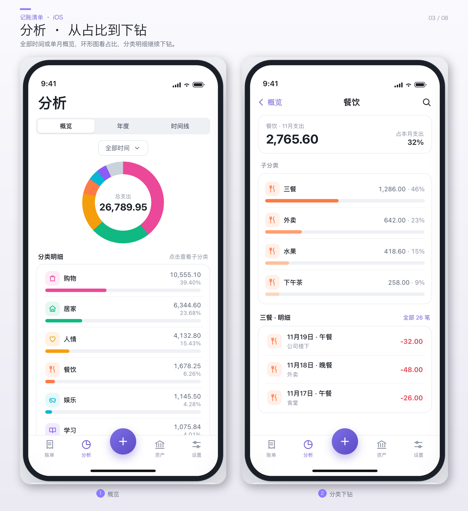
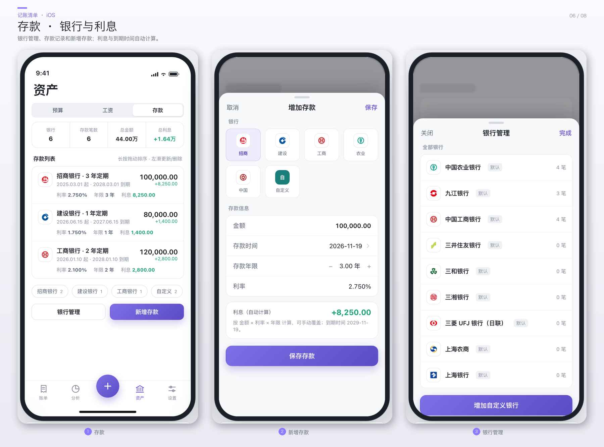
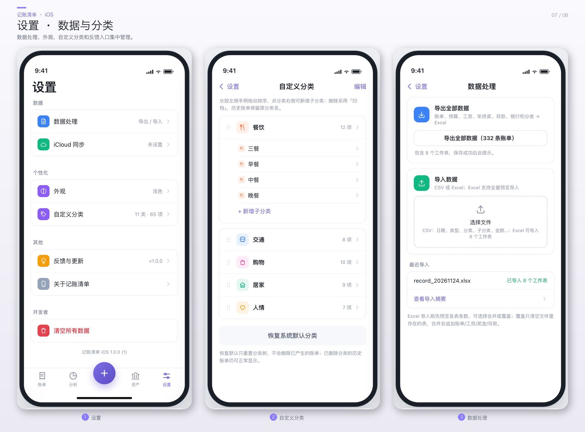
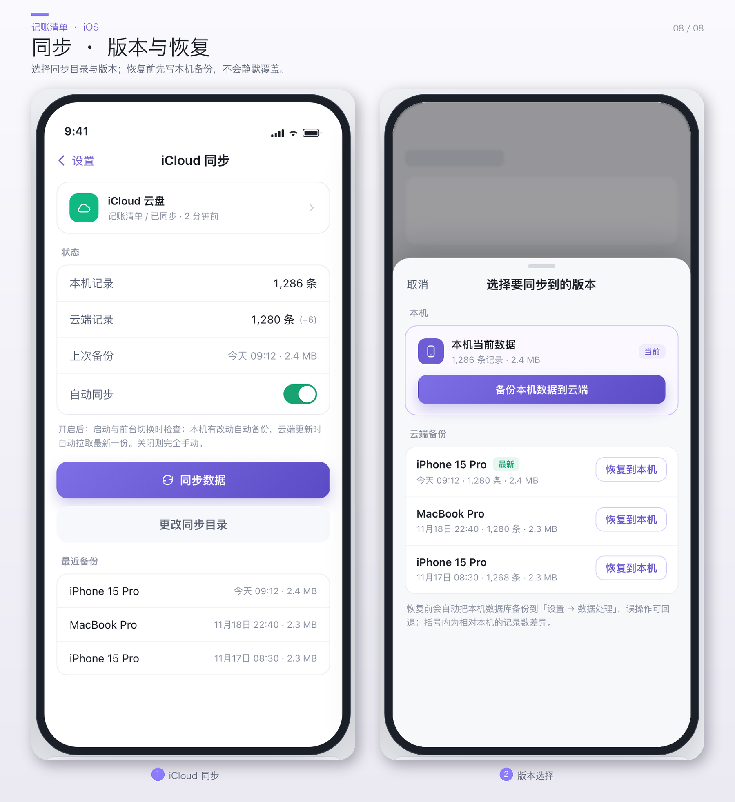

<div align="center">
  
  <h1>记账清单</h1>
  <p>把日常收支、预算、工资与存款，整理成一份清晰的本地账本。</p>
  <p><code>iOS 18+</code> · SwiftUI · SwiftData · Swift Charts</p>
</div>

**记账清单 iOS** 是把「记账清单」桌面版重构为 iPhone 原生应用的本地优先版本：账单、预算、工资、年终奖、存款和年度分析收进一个 App，数据默认只保存在本机 SwiftData 中；需要跨设备时，可把 JSON 快照写进 iCloud Drive、OneDrive 或任意文件目录，不依赖 CloudKit 付费账号。

## ✨ 它能做什么

- **快速记账**：底部中央「＋」一屏完成类型、金额、分类、日期和备注；支出与收入用不同颜色区分，记完回到原列表。
- **按天回看**：月度汇总固定在顶部，账单按日期分组；支持月份切换、关键词搜索和组合筛选。
- **分析概览**：默认「全部时间」，也可切到任意单月；环形图展示分类占比，分类明细继续下钻到子分类和单笔账单。
- **年度分析**：结余、近五年收支、支出月历、分类汇总；年份菜单位于结余卡片右侧，时间线串起全年关键事件。
- **资产中心**：预算、工资、存款三段切换，默认进入预算；预算进度、超支、工资个税和存款利息集中展示。
- **工资与个税**：累计预扣预缴税率表、五险一金扣除、本月/上月算税归属和年终奖单独计税；输入期间不实时重算，收起键盘或点完成后更新。
- **历史税额校准**：App 启动、切换算税月份、保存或删除工资时，检测历史税额差异并弹窗询问「重算 / 保留历史数据」。
- **银行与存款**：内置银行目录使用真实 Logo；存款自动计算利息与到期时间，支持排序、更新和删除。
- **搜索历史**：搜索页记录最近 10 条关键词，点历史直接重搜；记录只保存在本机。
- **本地优先同步**：手动/自动备份 JSON 快照到文件夹，也支持恢复桌面版 `.db` 快照；恢复前不会静默覆盖当前数据。
- **Excel 全量互通**：导出 8 个工作表；导入前预览各表条数，再选择合并导入或清空 Excel 中存在的表后覆盖导入。
- **App Icon**：使用 01A「账页紫光 · 金币印章」，源文件在 `prototype/icons/01-ledger-glow.svg`。

## 📸 功能展示

### 账单 · 一屏回看


月度汇总、按天分组、月份选择、搜索与组合筛选都在一个页面完成；顶部固定本月支出、收入和结余。

### 记一笔 · 一屏完成


类型、金额、分类、日期和备注一次填完；分类与子分类都有对应图标，保存后回到原列表。

### 分析 · 从占比到下钻



默认「全部时间」，环形图按支出分类汇总；分类明细展示图标、金额、占比和进度条，点击继续下钻。

### 年度 · 时间与结构


结余、近五年收支、支出月历和分类汇总集中在年度页；时间线按「最后一笔 / 大额支出 / 最大一笔支出 / 最大一笔收入」串起全年事件。

### 资产 · 预算与工资


预算、工资、存款三段切换，默认预算。工资详情固定展示算税月份、累计税率、税前和税额，不再提供手动税额切换。

### 存款 · 银行与利息



顶部固定银行数、存款笔数、总金额和总利息；存款利息与到期时间自动计算，银行管理使用真实银行 Logo。

### 设置 · 数据与分类



设置页集中管理数据处理、iCloud 同步、外观、自定义分类、反馈与更新和清空数据。

### 同步 · 版本与恢复



选择同步目录与版本；恢复前先写本机备份，并列出云端快照类型、时间、来源设备与条数。

## 🛫 快速开始

### 环境

- macOS + Xcode（iOS 18 SDK 或更高）
- iPhone 模拟器或 iOS 18+ 真机
- 无需 CocoaPods / 第三方运行时依赖

### 运行

```bash
open Record-iOS.xcodeproj
```

选择 `Record-iOS` scheme 和 iPhone 模拟器后运行。

命令行构建：

```bash
xcodebuild \
  -project Record-iOS.xcodeproj \
  -scheme Record-iOS \
  -sdk iphonesimulator \
  -destination 'platform=iOS Simulator,name=iPhone 18 Pro' \
  build CODE_SIGNING_ALLOWED=NO
```

### 首次使用

1. 在「账单」页点底部中央「＋」，添加第一笔记账。
2. 在「资产」页维护预算、工资和存款；工资会自动按累计预扣计算个税。
3. 在「设置 → iCloud 同步」选择同步目录，建立第一份 JSON 快照。
4. 在「设置 → 数据处理」导出 Excel 做备份，或导入已有账本。

## ☁️ 数据与同步

### 文件夹 JSON 快照

同步目录默认为 `记账清单/`，移动端会识别：

```text
<用户选择的目录>/记账清单/
├── record-backup-20261126_143000.json
├── record_20261126_143000.db
├── latest.json
└── *.categories.json
```

- `record-backup-*.json`：移动端 JSON 快照，包含账单、预算、工资、年终奖、存款、分类和手动银行。
- `record_*.db`：桌面版 SQLite 快照，恢复时保留本机内置银行，导入桌面端自定义银行。
- `latest.json`：桌面端版本提示，移动端不读取。
- 不使用 CloudKit / OneDrive SDK；依赖系统文件同步，不做条目级冲突合并。
- 恢复前自动把本机数据写入备份，避免误操作覆盖。

协议细节见 [`docs/mobile-backup-sync-protocol.md`](docs/mobile-backup-sync-protocol.md)。

### Excel 导入导出

- 导出 8 个工作表：账单、预算、工资、年终奖、存款、银行、分类、设置。
- 导出使用系统「保存到文件」，保存成功会提示。
- 导入前预览各表条数，可选择「合并导入」或「覆盖导入」。
- 覆盖只清空 Excel 中存在的表；合并会追加账单、工资、年终奖和存款，可能产生重复记录。
- CSV 仍可用于只导入账单。

### 历史税额校准

- 启动时检测历史工资税额与当前税率表的差异，弹窗询问是否重算。
- 选择「保留历史数据」会记录当前税率表版本，避免每次启动重复提示。
- 选择「重算」只更新税额和税率，不改动基本工资、加班费、奖金和五险一金。

## 🗂 数据存储

本机：

```text
Library/Application Support/Record.store
```

- SwiftData 数据库：账单、分类、银行、存款、工资、年终奖、预算。
- 工资算税配置：`UserDefaults` key `record.payroll.preferences.v1`。
- 预算配置：`UserDefaults` key `record.budget.preferences.v1`。
- 搜索历史：`UserDefaults` key `record.search.history.v1`。
- 内置银行：SwiftData `Bank` 表，`isSystem == true`；首次安装/升级时本地补齐，不写入云快照。
- 手动银行：`isSystem == false`，写入 JSON 快照的 `customBanks`。

模拟器数据可在 Xcode 的 Devices and Simulators 中查看容器；真机数据随 App 卸载删除，重要数据请先建立快照或导出 Excel。

## 🧩 项目结构

```text
Record-iOS/
├── Record-iOS/                 # SwiftUI App 源码
│   ├── Features/
│   │   ├── Ledger/             # 账单、详情、记一笔、搜索、筛选
│   │   ├── Analysis/           # 概览、年度、时间线、分类下钻
│   │   ├── Assets/             # 预算、工资、存款、银行管理
│   │   └── Settings/           # 同步、Excel 导入导出、桌面快照
│   ├── Models/                 # SwiftData 模型、种子数据、个税计算
│   ├── Design/                 # 主题、通用组件、日期选择、Toast
│   └── Resources/              # 本地化、银行 Logo、分类图标
├── Record-iOS.xcodeproj/
├── prototype/                  # HTML 高保真原型（23 屏）
│   ├── index.html
│   ├── icons.html              # 5 个 App Icon 方向，01A 已应用
│   └── icons/                  # 1024 SVG 图标源文件
├── tools/
│   └── make_guide_images.py    # 从原型截图生成 README 引导图
├── Scripts/
│   └── gen_l10n.py             # Localizable.strings → L10n.swift
├── docs/
│   ├── mobile-backup-sync-protocol.md
│   └── images/                 # README 引导图
└── README.md
```

## 🛠 开发

### 本地化

修改 `Record-iOS/Resources/zh-Hans.lproj/Localizable.strings` 后生成：

```bash
python3 Scripts/gen_l10n.py
```

### 原型

```bash
python3 prototype/build.py
open prototype/index.html
./prototype/capture.sh
```

原型说明见 [`prototype/README.md`](prototype/README.md)；App Icon 方案见 [`prototype/icons.html`](prototype/icons.html)。

### README 引导图

引导图由 `prototype/shots/` 下的原型分组截图裁切、排版生成，输出到 `docs/images/`：

```bash
./prototype/capture.sh
python3 -m pip install pillow
python3 tools/make_guide_images.py
```

修改原型后，先运行 `./prototype/capture.sh`，再重新生成引导图。

### 调试参数

仅在 DEBUG 构建生效：

| 参数 | 作用 |
| --- | --- |
| `-seedDemo` | 写入演示账单、资产、工资数据 |
| `-tab ledger/analysis/assets/settings` | 启动后直达对应 Tab |
| `-yearly` / `-timeline` | 分析页直达年度 / 时间线 |
| `-openSearch` / `-openFilter` | 打开搜索页 / 筛选页 |
| `-search=公司` | 配合 `-openSearch` 预填并搜索 |
| `-openEditor` | 打开新增账单页 |
| `-salary` / `-budget` / `-deposits` | 资产页直达工资 / 预算 / 存款 |
| `-openSalaryEditor` / `-openBonusEditor` | 打开工资 / 年终奖编辑器 |
| `-openDepositEditor` / `-openBanks` | 打开存款编辑器 / 银行管理 |
| `-openSync` / `-openSyncPicker` | 打开同步页 / 版本选择页 |
| `-openData` / `-excelImportPath <path>` / `-excelImportMode merge|replace` | 打开数据处理 / 自动导入 Excel / 跳过预览直接合并或覆盖 |
| `-skipTaxRecalcPrompt` | 调试时跳过历史税额重算弹窗 |

## ❓ 常见问题

**为什么没有 CloudKit 实时同步？**

当前是「文件夹 JSON 快照」方案：用户选择 iCloud Drive / OneDrive / 本地目录，App 负责写入和恢复快照。免费 Apple ID 可用，也不需要 CloudKit 付费账号。

**内置银行会同步到云端吗？**

不会。内置银行只在本机补齐，JSON 快照只携带手动添加的银行；桌面 `.db` 恢复时保留本机内置银行，导入桌面端非内置银行。

**Excel 导入会覆盖现有数据吗？**

导入前会先预览各表条数，再让你选择合并或覆盖。覆盖只清空 Excel 中存在的表；合并会追加账单、工资、年终奖和存款，可能产生重复记录。

**历史工资税额为什么被改过？**

启动、切换算税月份、保存或删除工资时，App 会检测历史税额与当前税率表的差异，并询问是否重算。选择保留会记录当前税率表版本，不会每次启动重复提示。

## ✅ 当前边界

- 不做账户 / 多用户；不引入银行卡账户体系。
- 不做 CloudKit / 实时双向同步；只在用户选择的文件夹写 JSON / `.db` 快照。
- 不做「不计入统计」；所有账单参与收支与结余，保留「计入预算」。
- Excel 覆盖导入只清空文件中存在的表；合并导入可能产生重复账单/工资/奖金/存款。
- 桌面端导入移动端 JSON 时，`customBanks` 字段需要桌面端同步支持；移动端自身已包含手动银行。
